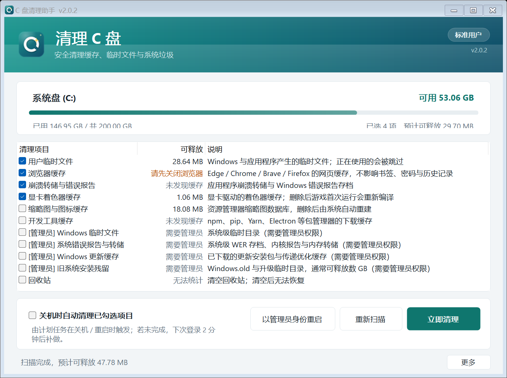
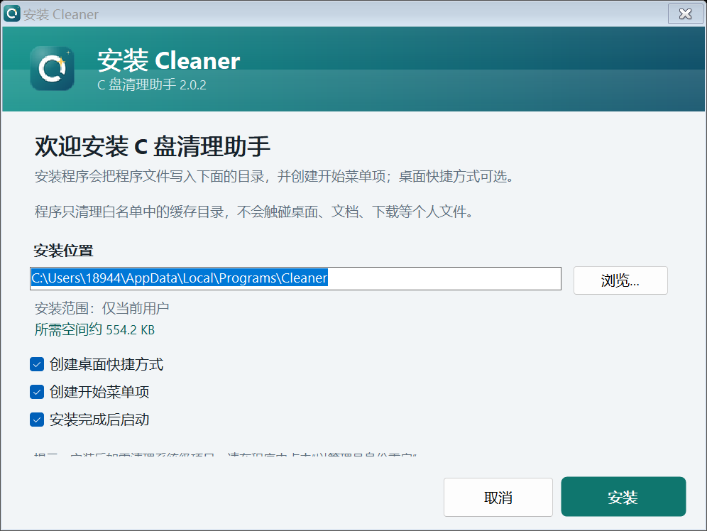
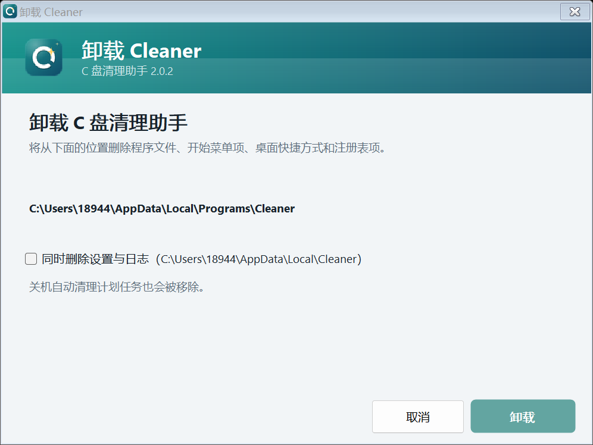
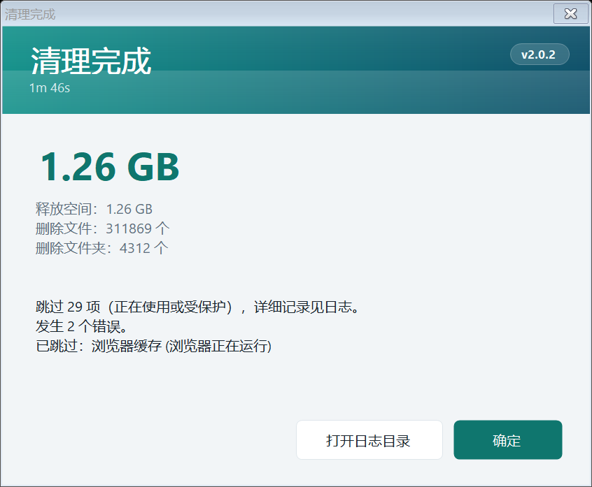
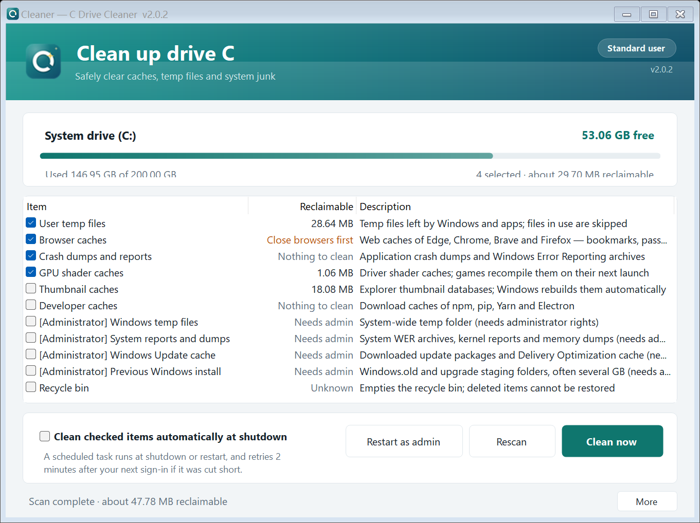

# Cleaner · C 盘清理助手

> 在原 [Hyruty/Cleaner](https://github.com/Hyruty/Cleaner)（PowerShell + WinForms，单脚本约 1,900 行）的基础上，
> 重写为**原生 .NET Framework 4.8 应用**并配套一个**真正的安装程序**。
> 全部离线构建：不依赖 NuGet、不需要 Visual Studio、不需要联网还原。



| 安装程序 | 卸载界面 |
| --- | --- |
|  |  |

| 清理结果 | 英文界面 |
| --- | --- |
|  |  |

---

## 1. 它做什么

清理 C 盘上可以安全重建的缓存与临时文件：

| 清理项目 | 默认 | 管理员 | 说明 |
| --- | :---: | :---: | --- |
| 用户临时文件 | ✅ | | `%TEMP%`、`%LOCALAPPDATA%\Temp` 内容 |
| 浏览器缓存 | ✅ | | Edge / Chrome / Brave / Vivaldi / Opera / Firefox 的 Cache、Code Cache、GPUCache 等 |
| 崩溃转储与错误报告 | ✅ | | `CrashDumps`、用户级 WER 存档 |
| 显卡着色器缓存 | ✅ | | `D3DSCache`、NVIDIA / AMD / Intel 着色器缓存 |
| 缩略图与图标缓存 | | | `thumbcache_*.db`、`iconcache_*.db`，由系统自动重建 |
| 开发工具缓存 | | | npm、pip、Yarn、Electron、NuGet 下载缓存 |
| Windows 临时文件 | | ✔ | `%WINDIR%\Temp`、`%WINDIR%\SystemTemp` |
| 系统错误报告与转储 | | ✔ | 系统级 WER、`LiveKernelReports`、`Minidump`、`MEMORY.DMP` |
| Windows 更新缓存 | | ✔ | `SoftwareDistribution\Download`、传递优化缓存 |
| 旧系统安装残留 | | ✔ | `Windows.old`、`$Windows.~BT`、`$Windows.~WS`、`$GetCurrent` |
| 回收站 | | | 清空回收站（不可恢复） |

程序**不会**触碰：桌面、文档、下载、图片、音乐、视频、浏览器书签 / 密码 / 历史记录 / Cookie、
已安装程序、游戏与个人文档；正在使用的文件会被跳过并记入日志。

---

## 2. 相比上游做了什么优化

完整的逐项对照见 [docs/优化说明.md](docs/优化说明.md)，要点：

| 维度 | 上游（PowerShell 脚本） | 本项目（原生应用） |
| --- | --- | --- |
| 运行方式 | `.ps1` + `.cmd` 启动器，依赖 PowerShell 5.1 与执行策略 | 单个 `Cleaner.exe`，无脚本宿主，启动更快 |
| 扫描 | 逐个目录串行扫描，界面阻塞（`DoEvents` 刷新） | 多类别并行扫描（`Task` + 信号量，最多 4 路），UI 线程不阻塞，可取消 |
| 长路径 | 受 `MAX_PATH` 限制 | 全程使用 `\\?\` 扩展路径 + `TargetFramework` 特性（同时修复了 CLR 传统路径模式问题） |
| 安全性 | 白名单 + 受保护目录校验 | 白名单 + 每个目标二次校验（根路径前缀、受保护路径、`..` 跳转）、跳过重解析点、只读属性清理、占用重试 |
| 多语言 | 单个 `strings.zh-CN.json` 外部文件 | 中英双语内置于 exe，支持 `lang.<culture>.json` 覆盖 |
| 国际化 UI | 固定 zh-CN | 跟随系统，可在「更多 → 界面语言」切换（重启生效） |
| 自动清理 | 复制脚本到 `%LOCALAPPDATA%\...\engine` 后注册计划任务 | 计划任务直接调用安装后的 `Cleaner.exe --scheduled`，界面与引擎同版本 |
| 设置 | `settings.json`（手写解析） | 同样的 JSON，自带解析器与原子写入，窗口位置 / 大小也会记住 |
| 日志 | 单一运行日志 | 同样的 `clean-*.log`，按 30 天清理，另加 `selftest.log` |
| 结果反馈 | MessageBox | 自定义结果对话框：释放空间、文件 / 文件夹数、跳过原因、一键打开日志 |
| 安装包 | 无（解压即用） | `CleanerSetup.exe`：安装 / 升级 / 静默 / 卸载，注册「应用和功能」条目、开始菜单、桌面快捷方式 |
| 可测试性 | `-SelfTest` / `-DryRun` | `--selftest`（20 项）/ `--dry-run` / `--clean` / `--ui-smoke` / `--screenshot`，安装包另有 `--selftest` |
| 依赖 | 系统 PowerShell + .NET Framework | 仅 .NET Framework 4.8（Windows 10 1903+ 自带） |

工程上的两个关键修复（都在自检里回归）：

1. **CLR 传统路径模式**：用 `csc` 直接编译出的程序如果没有
   `[assembly: TargetFramework(".NETFramework,Version=v4.8")]`，CLR 会退回 legacy 路径处理，
   `\\?\C:\...` 会被判为非法字符——深层临时目录（浏览器、npm）会被静默跳过。
2. **并行扫描下的字节统计**：单文件计数曾用赋值而非累加，导致多文件目录被低估（已修复并新增断言）。

---

## 3. 目录结构

```
Cleaner/
├─ src/
│  ├─ Cleaner.App/           主程序（C# 11 / .NET Framework 4.8 / WinForms）
│  │  ├─ Program.cs          入口、命令行、UI 启动、单实例、异常兜底
│  │  ├─ MainForm.cs         主界面（磁盘卡片、项目列表、自动清理、提权）
│  │  ├─ Theme.cs            配色与自绘控件（卡片、按钮、磁盘进度条、标题栏）
│  │  ├─ CleanupCatalog.cs   清理项目白名单与目标解析
│  │  ├─ CleanupEngine.cs    并行扫描 / 串行清理编排
│  │  ├─ FileScanner.cs      只读体积统计（跳过重解析点、可取消）
│  │  ├─ Deleter.cs          安全删除（属性清理、占用重试、跳过记录）
│  │  ├─ RecycleBin.cs       回收站 shell API + 文件系统兜底 + 结果校验
│  │  ├─ PathSafety.cs       路径规范化 / 受保护路径 / 目标校验
│  │  ├─ AutoCleanTask.cs    计划任务 XML、schtasks 注册 / 删除 / 查询
│  │  ├─ Settings.cs / Json.cs / Loc.cs / Log.cs / Native.cs / UserContext.cs
│  │  ├─ ResultDialog.cs     清理结果对话框
│  │  └─ SelfTests.cs        20 项无界面自检
│  ├─ Cleaner.Setup/         安装 / 卸载程序
│  │  ├─ Program.cs          参数解析、按需提权、静默模式、自检、截图
│  │  ├─ SetupForm.cs        三页向导（选项 / 进度 / 完成）
│  │  ├─ Installer.cs        复制文件、快捷方式、注册表、计划任务、自删除
│  │  ├─ Payload.cs          内嵌 zip 载荷的校验与解压
│  │  └─ Shortcuts.cs        .lnk 创建 / 删除、安装日志
│  └─ assets/                app.ico（多尺寸）、app.png
├─ build/
│  ├─ build.ps1              离线构建脚本（Roslyn csc + .NET Framework 引用程序集）
│  ├─ make-icon.py           图标生成脚本（Pillow）
│  ├─ app.manifest           主程序清单（asInvoker / DPI / 长路径 / Common Controls v6）
│  └─ setup.manifest         安装程序清单
├─ docs/
│  ├─ USAGE.txt              随程序安装的使用说明
│  ├─ 优化说明.md            与上游的逐项对照与工程细节
│  └─ images/                界面截图
├─ dist/                     构建产物：Cleaner.exe、CleanerSetup.exe
└─ README.md
```

---

## 4. 构建

**要求**：Windows 10/11，已安装 .NET Framework 4.8 引用程序集（VS Build Tools /
.NET Framework 4.8 Developer Pack 会提供）与 .NET SDK 7+（借用其中的 Roslyn，不需要 `dotnet restore`）。

```powershell
# 在项目根目录
powershell -NoProfile -ExecutionPolicy Bypass -File build\build.ps1
```

脚本会：

1. 定位 `dotnet` 自带的 Roslyn `csc.dll`（找不到时回退到 .NET Framework 自带的 `csc.exe`）；
2. 用 `.NET Framework 4.8` 引用程序集编译 `dist\Cleaner.exe`；
3. 运行 `Cleaner.exe --selftest`，任何一项失败都会终止构建；
4. 打包载荷（`Cleaner.exe` + `README.txt`）为 zip 资源，编译 `dist\CleanerSetup.exe`；
5. 输出两个产物的 SHA-256。

可选参数：`-AppOnly`（只编译主程序）、`-SkipTests`、`-Clean`。

图标可用 `python build\make-icon.py src\assets` 重新生成（需要 Pillow）。

---

## 5. 安装 / 升级 / 卸载

```powershell
dist\CleanerSetup.exe                        # 交互式安装（默认所有用户，需要时请求 UAC）
dist\CleanerSetup.exe /S                     # 静默安装
dist\CleanerSetup.exe /S /D=C:\Tools\Cleaner # 静默安装到指定目录
dist\CleanerSetup.exe /S /scope=user         # 仅当前用户（无需管理员）
dist\CleanerSetup.exe /uninstall             # 交互式卸载
dist\CleanerSetup.exe /S /uninstall          # 静默卸载
```

* 安装程序 `asInvoker`，需要时才自我提权；**拒绝 UAC 会自动降级为当前用户安装**
  （`%LOCALAPPDATA%\Programs\Cleaner`），不会安装失败。
* 写入「应用和功能」条目、开始菜单程序组（含卸载项）、可选桌面快捷方式与 `App Paths`。
* 升级安装会复用已有安装目录与安装范围，覆盖文件后刷新注册表项。
* 卸载会关闭正在运行的程序、移除计划任务、快捷方式与注册表项，最后通过
  `%TEMP%` 中的临时副本完成自删除（安装目录会被完全删除）。
* 卸载时可勾选一并删除 `%LOCALAPPDATA%\Cleaner`（设置与日志）。

---

## 6. 命令行

```
Cleaner.exe                          图形界面
Cleaner.exe --selftest               内置自检（20 项）
Cleaner.exe --dry-run                只统计不删除
Cleaner.exe --clean <ids>            命令行清理，如 --clean userTemp,browserCache
Cleaner.exe --scheduled              执行关机自动清理（计划任务调用）
Cleaner.exe --uninstall-auto         删除自动清理计划任务
Cleaner.exe --screenshot <png>       渲染界面截图（可加 --screenshot-wait N 先扫描）
Cleaner.exe --screenshot-result <png> 用样例数据渲染清理结果对话框
Cleaner.exe --ui-smoke               打开界面后自动退出（CI 冒烟）
               --categories <ids>    逗号分隔的类别
               --data-root <dir>     覆盖数据目录（测试用）
               --lang zh-CN|en-US    界面语言
```

安装程序：

```
CleanerSetup.exe --selftest          校验载荷与参数解析
CleanerSetup.exe --screenshot <png>  渲染向导截图
               /scope=machine|user  /desktop=0|1  /startmenu=0|1  /launch=0|1
```

---

## 7. 安全模型

* **白名单**：所有路径都由 `CleanupCatalog` 从固定根目录（`%LOCALAPPDATA%`、`%WINDIR%`、
  `%ProgramData%`、系统盘根）拼出，只有一个集中式的 `switch`，不含用户输入。
* **二次校验**：删除前对每个目标执行 `EnsureSafeTarget`：
  * 必须是规范化后的绝对路径；
  * 不能是驱动器根、Windows 目录、用户配置文件、桌面 / 文档 / 图片等受保护路径；
  * 必须位于该类别声明的根路径之下（前缀比较，含盘符根边界处理）；
  * 不允许包含 `..`。
* **不跟随链接**：扫描与删除都会跳过 `ReparsePoint`，避免顺着 junction 删到别处。
* **占用与权限**：只清理 `ReadOnly / Hidden / System` 属性后重试一次，仍失败则跳过并记录，
  绝不递归强删用户文件。
* **结果可验证**：回收站清理后轮询 shell 计数；失败会走文件系统兜底并如实报告。

---

## 8. 已知限制

* 浏览器缓存项在浏览器运行时会被跳过（提示「请先关闭浏览器」），避免破坏正在写入的缓存。
* 缩略图缓存被资源管理器占用时会跳过，注销或重启后清理更彻底。
* 「Windows 更新缓存」「旧系统安装残留」等系统级项目需要管理员权限，且可能被系统占用而部分跳过。
* 安装包**未做代码签名**，首次运行可能触发 SmartScreen 提示；如需分发请自行签名。
* 本沙箱环境禁止写注册表（HKCU/HKLM），因此「写入应用和功能条目」这一步无法在此自动化验证，
  其余流程（解压、快捷方式、卸载、自删除）均已实际跑通。

---

## 9. 更新记录

### 2.0.2
* **修复清理结果对话框在高 DPI 下布局错乱**：对话框漏了 `AutoScaleDimensions`，窗口不缩放
  而字体按 DPI 放大，导致文字重叠、按钮被挤出可见区域。已改为 `TableLayoutPanel` 布局，
  行高与按钮区随 DPI 正常缩放（新增 `--screenshot-result` 用于回归截图）。
* 自检的临时目录支持降级（`%TEMP%` → 数据目录），在受限机器上不再因无法建目录而误报失败。
* 构建脚本的自检改用 `obj\selftest-data` 独立数据目录，不再写入开发者真实设置。

### 2.0.1
* **修复「以管理员身份重启」只关闭窗口、不提权启动**：提权实例启动时旧窗口仍持有单实例
  互斥量，新实例被当成"重复启动"而自行退出。现在旧窗口在启动提权进程后先释放互斥量，
  新实例带 `--handoff` 等待接管（最长约 22 秒），超时会写日志而不是静默消失。
* 修复命令行参数引号转义：以反斜杠结尾的路径会吞掉结尾引号（已用 .NET Framework 真实解析器验证）。
* 构建脚本：自检失败现在会真正中断构建（GUI 子系统程序此前不会阻塞 PowerShell）。
* 自检从 18 项增加到 20 项（新增参数引号、单实例交接）。

### 2.0.0
* 首次发布：从上游 PowerShell 脚本重写为原生应用 + 安装程序。

---

## 10. 来源与致谢

* 上游项目：[Hyruty/Cleaner](https://github.com/Hyruty/Cleaner)（PowerShell + WinForms 单脚本）。
* 本项目保留其清理范围与安全边界，重写实现并补齐安装 / 卸载 / 自检 / 双语。
* 图标为重新绘制的多尺寸 ICO（16–256 px），与上游人物图标无关。
